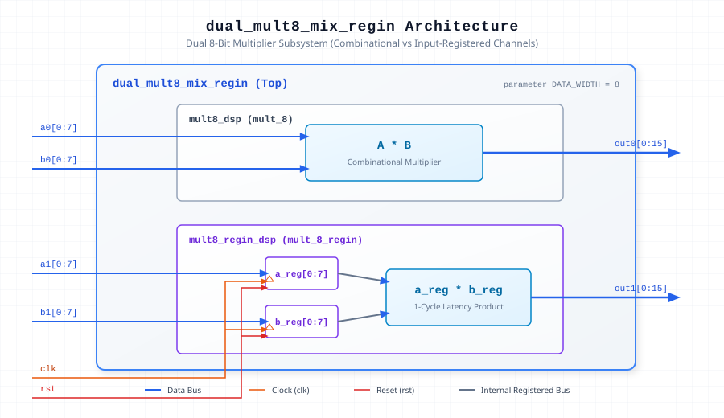

.. _datasheet_dsp_dual_mult8_mix_regin:

dual_mult8_mix_regin
--------------------

Introduction
~~~~~~~~~~~~

The ``dual_mult8_mix_regin`` module implements two parallel 8-bit multiplier channels. 
Channel 0 (`mult8_dsp`) operates as a purely combinational multiplier, computing the product without latency. 
Channel 1 (`mult8_regin_dsp`) integrates synchronous input registers on operands `a1` and `b1`, introducing a single clock cycle latency before presenting the multiplication result on output `out1`.

Source Codes
~~~~~~~~~~~~

See details in ``dsp/mult/dual_mult8_mix_regin``

Block Diagram
~~~~~~~~~~~~~

  Dual 8-bit Mixed Register Multiplier schematic

Parameters
~~~~~~~~~~~

.. list-table:: Module Parameters
  :header-rows: 1
  :class: longtable

  * - Parameter
    - Default
    - Description
  * - ``DATA_WIDTH``
    - ``8``
    - Bit width of input operands `a0`, `b0`, `a1`, and `b1`. Output widths are doubled (`2 * DATA_WIDTH`).

Ports
~~~~~

.. list-table:: Module Ports
  :header-rows: 1
  :class: longtable

  * - Port Name
    - Direction
    - Width
    - Description
  * - ``clk``
    - Input
    - 1
    - System clock input for channel 1 input registers.
  * - ``rst``
    - Input
    - 1
    - Synchronous reset for channel 1 input registers.
  * - ``a0``
    - Input
    - ``DATA_WIDTH``
    - Multiplicand input for combinational channel 0.
  * - ``b0``
    - Input
    - ``DATA_WIDTH``
    - Multiplier input for combinational channel 0.
  * - ``out0``
    - Output
    - ``2*DATA_WIDTH``
    - Combinational multiplication product output (`a0 * b0`).
  * - ``a1``
    - Input
    - ``DATA_WIDTH``
    - Multiplicand input for registered channel 1.
  * - ``b1``
    - Input
    - ``DATA_WIDTH``
    - Multiplier input for registered channel 1.
  * - ``out1``
    - Output
    - ``2*DATA_WIDTH``
    - Registered multiplication product output (`a1 * b1` after 1 clock cycle).

Performance & Resource Utilization
~~~~~~~~~~~~~~~~~~~~~~~~~~~~~~~~~~

Estimated hardware resource usage when targeted for standard modern FPGA logic architectures:

.. list-table:: Estimated Resource Utilization
  :header-rows: 1
  :class: longtable

  * - Benchmark
    - Inputs
    - Outputs
    - LUT5
    - FF
    - DSP
    - BRAM
  * - Dual Multiplier (8-bit)
    - 34
    - 32
    - 0
    - 16
    - 2
    - 0
