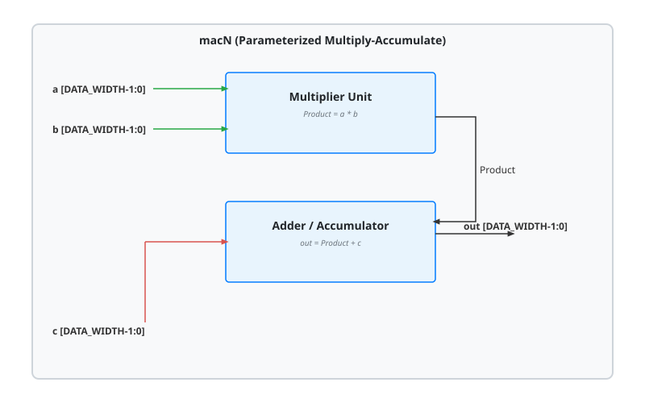

.. _datasheet_dsp_macN:

N-bit Multiply-Accumulate Circuit (mac_N)
-----------------------------------------

Introduction
~~~~~~~~~~~~

.. note:: The output of the MAC are truncated by half. In regular MAC, the output should contain at least ``2*N`` bits while it is reduced to ``N`` bits.

This module implements a parameterized N-bit multiply-accumulate (MAC) circuit.
It computes the arithmetic operation where input ``a`` is multiplied by input ``b``, and the product is added to input ``c`` (``out = a * b + c``). The data width is fully configurable via the ``DATA_WIDTH`` parameter.

Source codes
~~~~~~~~~~~~

See details in ``dsp/mac``

The following designs are available

- mac_12
- mac_16
- mac_18
- mac_2
- mac_20
- mac_32
- mac_36
- mac_4
- mac_6
- mac_8
- mac_8_9
- mac_9

Block Diagram
~~~~~~~~~~~~~

  macN schematic

Performance
~~~~~~~~~~~

Expect to consume hardware multiplier and adder resources scaling with the configured data width (N).

.. warning:: The following resource utilization is just an estimation! Different tools in different versions may result differently.

.. list-table:: Estimated resource Utilization across Data Widths
  :header-rows: 1
  :class: longtable

  * - Configuration
    - Inputs
    - Outputs
    - LUT4
    - FF
    - Carry
    - DSP
    - BRAM
  * - mac_2
    - 6
    - 2
    - ~4
    - 0
    - ~2
    - 0
    - 0
  * - mac_4
    - 12
    - 4
    - ~8
    - 0
    - ~4
    - 0
    - 0
  * - mac_6
    - 18
    - 6
    - ~12
    - 0
    - ~6
    - 0
    - 0
  * - mac_8
    - 24
    - 8
    - ~16
    - 0
    - ~8
    - 1
    - 0
  * - mac_9
    - 27
    - 9
    - ~20
    - 0
    - ~9
    - 1
    - 0
  * - mac_12
    - 36
    - 12
    - ~36
    - 0
    - ~12
    - 1
    - 0
  * - mac_16
    - 48
    - 16
    - ~64
    - 0
    - ~16
    - 1
    - 0
  * - mac_18
    - 54
    - 18
    - ~80
    - 0
    - ~18
    - 1
    - 0
  * - mac_20
    - 60
    - 20
    - ~100
    - 0
    - ~20
    - 1 (cascaded)
    - 0
  * - mac_32
    - 96
    - 32
    - ~256
    - 0
    - ~32
    - 2 (cascaded)
    - 0
  * - mac_36
    - 108
    - 36
    - ~324
    - 0
    - ~36
    - 2 (cascaded)
    - 0
