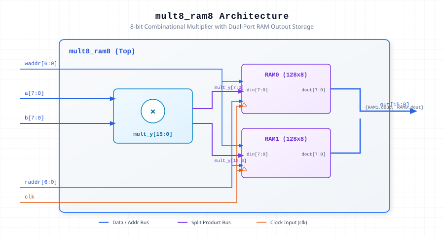

.. _datasheet_dsp_mult8_ram8:

mult8_ram8
----------

Introduction
~~~~~~~~~~~~

The ``mult8_ram8`` module computes an 8-bit unsigned multiplication product (`a * b`) and splits the resulting 16-bit product into lower and upper 8-bit halves. These halves are concurrently written into and read back from dual-port RAM storage blocks (``RAM0`` and ``RAM1``) synchronized to the system clock (`clk`).

Source Codes
~~~~~~~~~~~~

See details in ``dsp/mult/mult8_ram8``

Block Diagram
~~~~~~~~~~~~~

  8-bit Multiplier with Dual-Port RAM schematic

Ports
~~~~~

.. list-table:: Module Ports
  :header-rows: 1
  :class: longtable

  * - Port Name
    - Direction
    - Width
    - Description
  * - ``a``
    - Input
    - 8
    - 8-bit multiplicand input.
  * - ``b``
    - Input
    - 8
    - 8-bit multiplier input.
  * - ``clk``
    - Input
    - 1
    - System clock input for dual-port RAM write and read operations.
  * - ``waddr``
    - Input
    - 7
    - 7-bit write address bus for RAM blocks.
  * - ``raddr``
    - Input
    - 7
    - 7-bit read address bus for RAM blocks.
  * - ``out``
    - Output
    - 16
    - 16-bit product output read back from RAM storage.

Performance & Resource Utilization
~~~~~~~~~~~~~~~~~~~~~~~~~~~~~~~~~~

Estimated hardware resource usage when targeted for standard modern FPGA architectures:

.. list-table:: Estimated Resource Utilization
  :header-rows: 1
  :class: longtable

  * - Benchmark
    - Inputs
    - Outputs
    - LUT5
    - FF
    - DSP
    - BRAM
  * - Mult8 with RAM Storage
    - 24
    - 16
    - 12
    - 16
    - 1
    - 1
