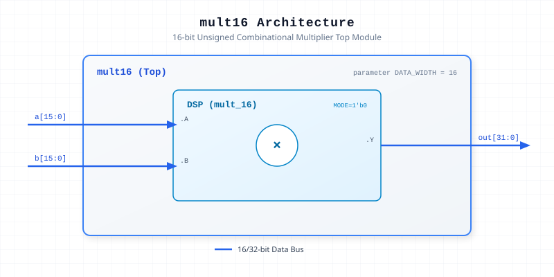

.. _datasheet_dsp_multN:

Macro-based N-bit Multiplier 
----------------------------

Introduction
~~~~~~~~~~~~

These modules provides a N-bit unsigned combinational multiplier wrapper. It instantiates a macro submodule (``mult_N``) with a configurable mode parameter to execute multiplication without clock latency.

These modules aim to validate FPGA tool chain on mapping hard macros.

Source Codes
~~~~~~~~~~~~

.. note:: When using the benchmarks, please do **NOT** include the ``multN.v``

See details in 

- ``dsp/mult/mult8``
- ``dsp/mult/mult16``

Block Diagram
~~~~~~~~~~~~~

The following is an example of the 16-bit version

  16-bit Multiplier schematic

Performance & Resource Utilization
~~~~~~~~~~~~~~~~~~~~~~~~~~~~~~~~~~

Estimated hardware resource usage when targeted for standard modern FPGA architectures:

.. list-table:: Estimated Resource Utilization
  :header-rows: 1
  :class: longtable

  * - Benchmark
    - Inputs
    - Outputs
    - LUT5
    - FF
    - DSP
    - BRAM
  * - 8-bit Multiplier
    - 16
    - 16
    - 0
    - 0
    - 1
    - 0
  * - 16-bit Multiplier
    - 32
    - 32
    - 0
    - 0
    - 1
    - 0
