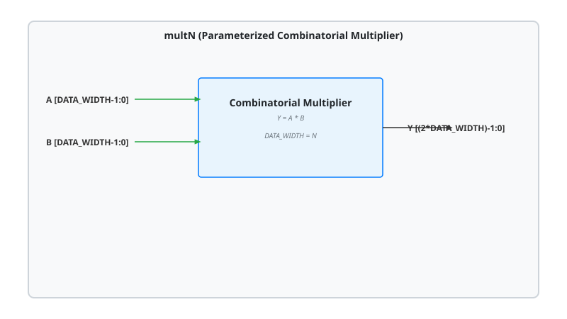

.. _datasheet_dsp_mult_NxN:

N-bit Combinatorial Multiplier (mult_NxN)
-----------------------------------------

Introduction
~~~~~~~~~~~~

This module implements a parameterized N-bit combinatorial multiplier, generalizing the 2-bit design created by Xifan Tang. It multiplies two parameterized $N$-bit inputs, ``A`` and ``B``, and produces a wide product output ``Y`` of width ``2N`` (:math:`Y = A \times B`). Because it is purely combinatorial, outputs settle immediately upon input changes without requiring clock synchronization.

Source codes
~~~~~~~~~~~~

See details in 

- ``dsp/mult/mult_2x2``
- ``dsp/mult/mult_4x4``
- ``dsp/mult/mult_8``
- ``dsp/mult/mult_16``

Block Diagram
~~~~~~~~~~~~~

  multN schematic

Performance
~~~~~~~~~~~

Consumes combinatorial logic LUTs, carry chains, and potentially DSP blocks depending on the configured data width (``N``).

.. warning:: The following resource utilization is just an estimation! Different tools in different versions may result differently.

.. list-table:: Estimated resource Utilization across Data Widths
  :header-rows: 1
  :class: longtable

  * - Configuration
    - Inputs
    - Outputs
    - LUT4
    - FF
    - Carry
    - DSP
    - BRAM
  * - mult_2 
    - 4
    - 4
    - ~4
    - 0
    - ~2
    - 0
    - 0
  * - mult_4
    - 8
    - 8
    - ~16
    - 0
    - ~8
    - 0
    - 0
  * - mult_8
    - 16
    - 16
    - ~64
    - 0
    - ~16
    - 1
    - 0
  * - mult_16
    - 32
    - 32
    - ~256
    - 0
    - ~32
    - 1
    - 0
  * - mult_32
    - 64
    - 64
    - ~1024
    - 0
    - ~64
    - 4
    - 0
