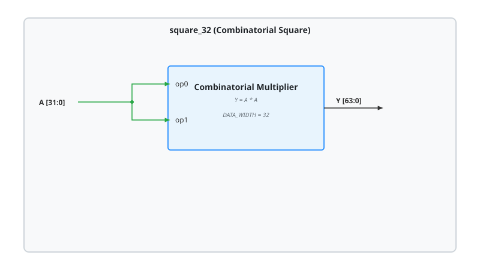

.. _datasheet_dsp_square_32:

square_32
---------

Introduction
~~~~~~~~~~~~

The ``square_32`` module squares a 32-bit unsigned input ``A`` and produces a 64-bit product ``Y`` (:math:`Y = A \times A`). It is purely combinatorial.

Since the same input drives both operands of the multiplier, a design mapped onto a hard multiplier needs ``A`` to reach both operand ports of the block. This exercises how a tool routes one signal to both operands, *e.g.*, through a programmable multiplexer which selects the source of an operand.

Source Codes
~~~~~~~~~~~~

See details in ``dsp/mult/square_32``

Block Diagram
~~~~~~~~~~~~~

  square_32 schematic

Ports
~~~~~

.. list-table:: Module Ports
  :header-rows: 1
  :class: longtable

  * - Port Name
    - Direction
    - Width
    - Description
  * - ``A``
    - Input
    - 32
    - Input to be squared, which drives both operands of the multiplier.
  * - ``Y``
    - Output
    - 64
    - Product ``A * A``.

Performance
~~~~~~~~~~~

Same as a 32-bit multiplier (see :ref:`datasheet_dsp_mult_NxN`), with half of the inputs.

.. warning:: The following resource utilization is just an estimation! Different tools in different versions may result differently.

.. list-table:: Estimated Resource Utilization
  :header-rows: 1
  :class: longtable

  * - Benchmark
    - Inputs
    - Outputs
    - LUT4
    - FF
    - Carry
    - DSP
    - BRAM
  * - square_32
    - 32
    - 64
    - ~1024
    - 0
    - ~64
    - 4
    - 0
