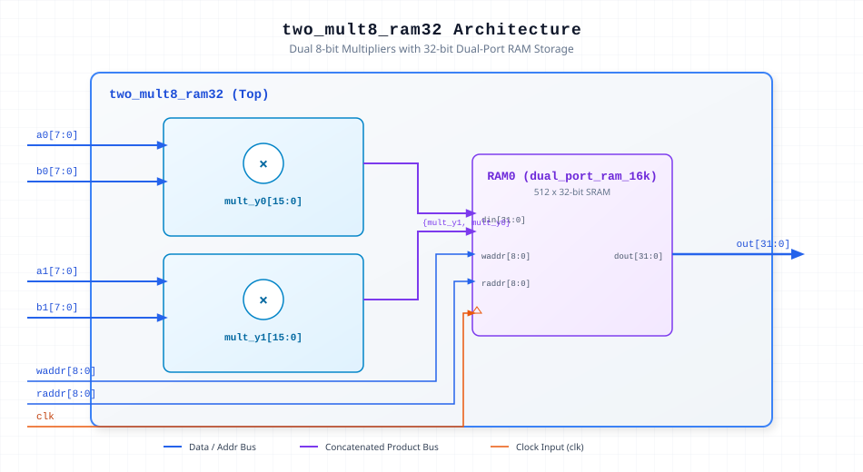

.. _datasheet_dsp_two_mult8_ram32:

two_mult8_ram32
---------------

Introduction
~~~~~~~~~~~~

The ``two_mult8_ram32`` module computes two parallel 8-bit unsigned multiplications (``a0 * b0`` and ``a1 * b1``) and concatenates their 16-bit products into a single 32-bit word (``{mult_y1, mult_y0}``). This combined word is written into and read back from a 1024x32 dual-port RAM block (``dual_port_ram_16k``) synchronized to the system clock (``clk``).

Source Codes
~~~~~~~~~~~~

See details in ``dsp/mult/two_mult8_ram32``

Block Diagram
~~~~~~~~~~~~~

  Dual 8-bit Multiplier with 32-bit Dual-Port RAM schematic

Ports
~~~~~

.. list-table:: Module Ports
  :header-rows: 1
  :class: longtable

  * - Port Name
    - Direction
    - Width
    - Description
  * - ``a0``
    - Input
    - 8
    - Multiplicand input for channel 0 multiplier.
  * - ``b0``
    - Input
    - 8
    - Multiplier input for channel 0 multiplier.
  * - ``a1``
    - Input
    - 8
    - Multiplicand input for channel 1 multiplier.
  * - ``b1``
    - Input
    - 8
    - Multiplier input for channel 1 multiplier.
  * - ``clk``
    - Input
    - 1
    - System clock input for dual-port RAM write and read operations.
  * - ``waddr``
    - Input
    - 9
    - 9-bit write address bus for the dual-port RAM.
  * - ``raddr``
    - Input
    - 9
    - 9-bit read address bus for the dual-port RAM.
  * - ``out``
    - Output
    - 32
    - 32-bit concatenated product output read back from RAM storage.

Performance & Resource Utilization
~~~~~~~~~~~~~~~~~~~~~~~~~~~~~~~~──

Estimated hardware resource usage when targeted for standard modern FPGA architectures:

.. list-table:: Estimated Resource Utilization
  :header-rows: 1
  :class: longtable

  * - Benchmark
    - Inputs
    - Outputs
    - LUT5
    - FF
    - DSP
    - BRAM
  * - Dual Multiplier with 32-bit RAM
    - 35
    - 32
    - 18
    - 32
    - 2
    - 1
