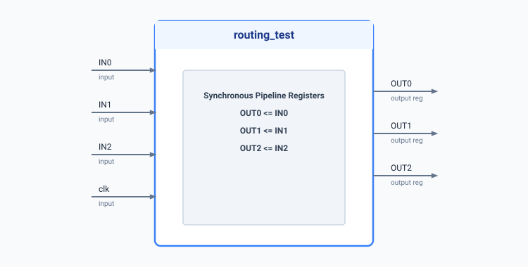

.. _datasheet_interface_routing_test:

routing_test
------------

Introduction
~~~~~~~~~~~~

This benchmark is designed to test basic signal routing, pipeline registration, and Look-Up Table (LUT) or register mapping in FPGAs.
It is a simple synchronous routing module that latches three independent 1-bit inputs (`IN0`, `IN1`, `IN2`) onto corresponding registered outputs (`OUT0`, `OUT1`, `OUT2`) on each positive clock edge.

Source codes
~~~~~~~~~~~~

See details in ``interface/routing_test``

Block Diagram
~~~~~~~~~~~~~

  routing_test schematic

Performance
~~~~~~~~~~~

Expect to consume 3 flip-flops and minimal combinational routing resources in an FPGA.
It can reflect the timing and routing efficiency of register mapping and parallel data path transmission in FPGA logic elements.

.. warning:: The following resource utilization is just an estimation! Different tools in different versions may result differently.

.. list-table:: Estimated resource Utilization
  :header-rows: 1
  :class: longtable

  * - Tool/Resource
    - Inputs
    - Outputs
    - LUT4
    - FF
    - Carry
    - DSP
    - BRAM
  * - General
    - 4
    - 3
    - 0
    - 3
    - 0
    - 0
    - 0
