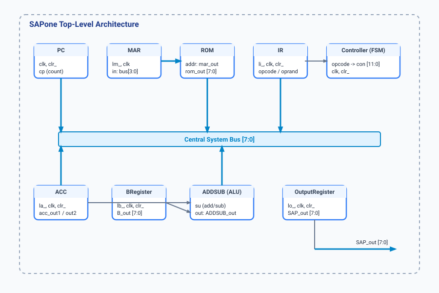

.. _datasheet_sapone:

SAP-1 8-Bit Computer (SAPone)
-----------------------------

Introduction
~~~~~~~~~~~~

The ``SAPone`` module implements a complete SAP-1 (Simple-As-Possible) 8-bit educational computer architecture[cite: 17]. 
It integrates a centralized FSM controller, program ROM memory, an instruction register, an ALU supporting addition and subtraction, and multiple working registers connected via an internal system bus[cite: 11, 16, 17].

Source codes
~~~~~~~~~~~~

See details in ``interface/SAPone``

Block Diagram
~~~~~~~~~~~~~

  SAP-1 Computer schematic

Architecture & Major Features
~~~~~~~~~~~~~~~~~~~~~~~~~~~~~

The SAPone core consists of the following primary submodules:

- **Program Counter (PC)**: 4-bit synchronous counter tracking instruction addresses[cite: 15].
- **Memory Address Register (MAR)**: Latches address inputs for ROM access[cite: 13].
- **Program ROM**: Provides instruction and data bytes based on MAR address lines[cite: 16].
- **Instruction Register (IR)**: Splits incoming bytes into a 4-bit opcode and 4-bit operand[cite: 12].
- **Controller**: Finite state machine that decodes opcodes and generates a 12-bit control word (`con`)[cite: 11].
- **Accumulator (ACC)**: Stores working arithmetic results with dual outputs[cite: 8].
- **Adder/Subtractor (ADDSUB)**: Combinational ALU performing addition or subtraction governed by the ``su`` control signal[cite: 9].
- **B-Register**: Temporary operand holding register for ALU operations[cite: 10].
- **Output Register**: Latches final values onto the external ``SAP_out`` display bus[cite: 14].

Supported Instructions
^^^^^^^^^^^^^^^^^^^^^^

The internal FSM controller supports the following instruction set architecture (ISA)[cite: 11]:
- ``LDA`` (Opcode 0x0): Load Accumulator from memory[cite: 11, 16].
- ``ADD`` (Opcode 0x1, 0x2): Add memory content to Accumulator[cite: 11, 16].
- ``SUB`` (Opcode 0x3): Subtract memory content from Accumulator[cite: 11, 16].
- ``OUT`` (Opcode 0xe): Transfer Accumulator value to output display register[cite: 11, 16].
- ``HLT`` (Opcode 0xf): Halt execution[cite: 11, 16].

Performance
~~~~~~~~~~~

.. warning:: The following resource utilization is just an estimation! Different tools in different versions may result differently.

.. list-table:: Estimated Resource Utilization
  :header-rows: 1
  :class: longtable

  * - Tool/Resource
    - Inputs
    - Outputs
    - LUT4
    - FF
    - Carry
    - DSP
    - BRAM
  * - General
    - 2
    - 20
    - 135
    - 52
    - 4
    - 0
    - 0

IO Ports
~~~~~~~~

.. table:: SAPone Top-Level Ports

  +------------+-------+-----------+------------------------------------+
  | Port       | Width | Direction | Description                        |
  +------------+-------+-----------+------------------------------------+
  | clk        | 1     | Input     | System clock input[cite: 17]      |
  +------------+-------+-----------+------------------------------------+
  | clr_       | 1     | Input     | Active-low asynchronous clear[cite: 17]|
  +------------+-------+-----------+------------------------------------+
  | SAP_out    | 8     | Output    | Output register bus data[cite: 17]|
  +------------+-------+-----------+------------------------------------+
  | con        | 12    | Output    | Control word status signals[cite: 17]|
  +------------+-------+-----------+------------------------------------+
  | bus        | 8     | Inout     | Central internal data bus[cite: 17]|
  +------------+-------+-----------+------------------------------------+
