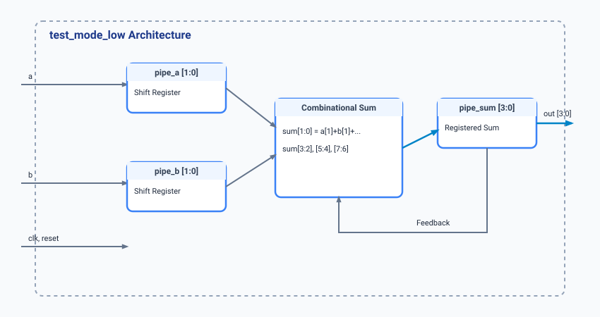

.. _datasheet_interface_test_mode_low:

test_mode_low
-------------

Introduction
~~~~~~~~~~~~

The ``test_mode_low`` module implements a 2x2 low-density test mode pipeline circuit. 
It takes two 1-bit inputs (`a` and `b`), shifts them through dual-stage pipeline registers (`pipe_a`, `pipe_b`), and computes feedback-driven intermediate sums across combinatorial assignment blocks before registering the final 4-bit output vector (`out`).

Source codes
~~~~~~~~~~~~

See details in ``interface/test_mode_low``

Block Diagram
~~~~~~~~~~~~~

  test_mode_low schematic

Performance
~~~~~~~~~~~

Expect to consume low-to-moderate FPGA logic resources, primarily utilizing pipeline flip-flops for bit shifting and small combinatorial logic blocks for internal bit summation.

.. warning:: The following resource utilization is just an estimation! Different tools in different versions may result differently.

.. list-table:: Estimated Resource Utilization
  :header-rows: 1
  :class: longtable

  * - Tool/Resource
    - Inputs
    - Outputs
    - LUT4
    - FF
    - Carry
    - DSP
    - BRAM
  * - General
    - 4
    - 4
    - 14
    - 8
    - 2
    - 0
    - 0

IO Ports
~~~~~~~~

.. table:: test_mode_low Top-Level Ports

  +------------+-------+-----------+------------------------------------+
  | Port       | Width | Direction | Description                        |
  +------------+-------+-----------+------------------------------------+
  | a          | 1     | Input     | Data input A            |
  +------------+-------+-----------+------------------------------------+
  | b          | 1     | Input     | Data input B            |
  +------------+-------+-----------+------------------------------------+
  | clk        | 1     | Input     | System clock input      |
  +------------+-------+-----------+------------------------------------+
  | reset      | 1     | Input     | Asynchronous reset input|
  +------------+-------+-----------+------------------------------------+
  | out        | 4     | Output    | Pipelined 4-bit output vector|
  +------------+-------+-----------+------------------------------------+
