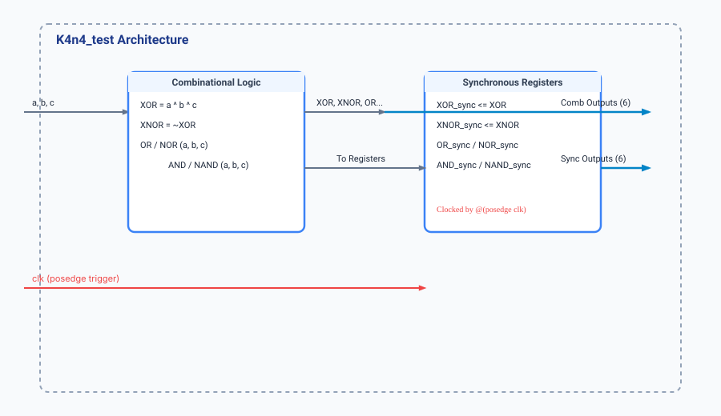

.. _datasheet_interface_k4n4_test:

K4n4_test_modes
---------------

Introduction
~~~~~~~~~~~~

The ``K4n4_test`` module is a combinatorial logic benchmark designed to evaluate basic multi-input gate operations (XOR, XNOR, OR, NOR, AND, NAND) and their synchronized register counterparts. 
It computes parallel logical evaluations across three 1-bit inputs (``a``, ``b``, ``c``) and registers the resulting states on the positive edge of the system clock (`clk`).

Source codes
~~~~~~~~~~~~

See details in ``interface/K4N4_test_modes.v``

Block Diagram
~~~~~~~~~~~~~

  K4n4_test schematic

Performance
~~~~~~~~~~~

Expect to consume minimal FPGA logic cells and combinational Look-Up Tables (LUTs) along with 6 synchronization flip-flops. 
It measures multi-input logic propagation delay and synchronous register mapping efficiency.

.. warning:: The following resource utilization is just an estimation! Different tools in different versions may result differently.

.. list-table:: Estimated Resource Utilization
  :header-rows: 1
  :class: longtable

  * - Tool/Resource
    - Inputs
    - Outputs
    - LUT4
    - FF
    - Carry
    - DSP
    - BRAM
  * - General
    - 4
    - 12
    - 6
    - 6
    - 0
    - 0
    - 0

IO Ports
~~~~~~~~

.. table:: K4n4_test Top-Level Ports

  +------------+-------+-----------+------------------------------------+
  | Port       | Width | Direction | Description                        |
  +------------+-------+-----------+------------------------------------+
  | clk        | 1     | Input     | System clock input      |
  +------------+-------+-----------+------------------------------------+
  | a          | 1     | Input     | Data input A            |
  +------------+-------+-----------+------------------------------------+
  | b          | 1     | Input     | Data input B            |
  +------------+-------+-----------+------------------------------------+
  | c          | 1     | Input     | Data input C            |
  +------------+-------+-----------+------------------------------------+
  | XOR        | 1     | Output    | Combinational 3-input XOR|
  +------------+-------+-----------+------------------------------------+
  | XNOR       | 1     | Output    | Combinational 3-input XNOR|
  +------------+-------+-----------+------------------------------------+
  | AND        | 1     | Output    | Combinational 3-input AND|
  +------------+-------+-----------+------------------------------------+
  | NAND       | 1     | Output    | Combinational 3-input NAND|
  +------------+-------+-----------+------------------------------------+
  | OR         | 1     | Output    | Combinational 3-input OR |
  +------------+-------+-----------+------------------------------------+
  | NOR        | 1     | Output    | Combinational 3-input NOR|
  +------------+-------+-----------+------------------------------------+
  | XOR_sync   | 1     | Output    | Registered XOR output   |
  +------------+-------+-----------+------------------------------------+
  | XNOR_sync  | 1     | Output    | Registered XNOR output  |
  +------------+-------+-----------+------------------------------------+
  | AND_sync   | 1     | Output    | Registered AND output   |
  +------------+-------+-----------+------------------------------------+
  | NAND_sync  | 1     | Output    | Registered NAND output  |
  +------------+-------+-----------+------------------------------------+
  | OR_sync    | 1     | Output    | Registered OR output    |
  +------------+-------+-----------+------------------------------------+
  | NOR_sync   | 1     | Output    | Registered NOR output   |
  +------------+-------+-----------+------------------------------------+
