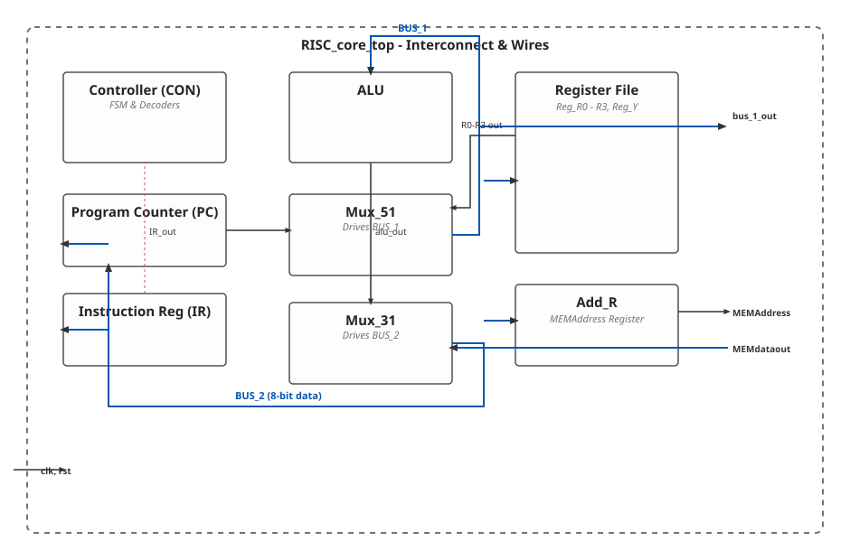

.. _datasheet_processors_risc_posedge_clk:

8-bit Simple RISC Core Processor
--------------------------------

Introduction
~~~~~~~~~~~~

This module and its associated submodules implement a complete 8-bit RISC processor architecture. The core integrates an arithmetic logic unit (ALU) supporting addition, subtraction, bitwise AND, and NOT operations, a multi-state instruction controller FSM, an 8-bit program counter (PC), an instruction register (IR), four general-purpose registers (R0 to R3)[cite: 11], supporting multiplexers, and a 256x8 memory block.

Source codes
~~~~~~~~~~~~

See details in ``processors/RISC_posedge_clk``

Block Diagram
~~~~~~~~~~~~~

  RISC core system schematic

Performance
~~~~~~~~~~~

Expect to consume moderate FPGA resources (approximately 150 LUTs and 64 flip-flops, plus a Block RAM or distributed memory equivalent for the 256x8 memory array) to implement the 8-bit data paths, control FSM, and register file.

.. warning:: The following resource utilization is just an estimation! Different tools in different versions may result differently.

.. list-table:: Estimated resource Utilization
  :header-rows: 1
  :class: longtable

  * - Tool/Resource
    - Inputs
    - Outputs
    - LUT4
    - FF
    - Carry
    - DSP
    - BRAM
  * - General
    - 2
    - 8
    - ~150
    - ~64
    - ~16
    - 0
    - 1
