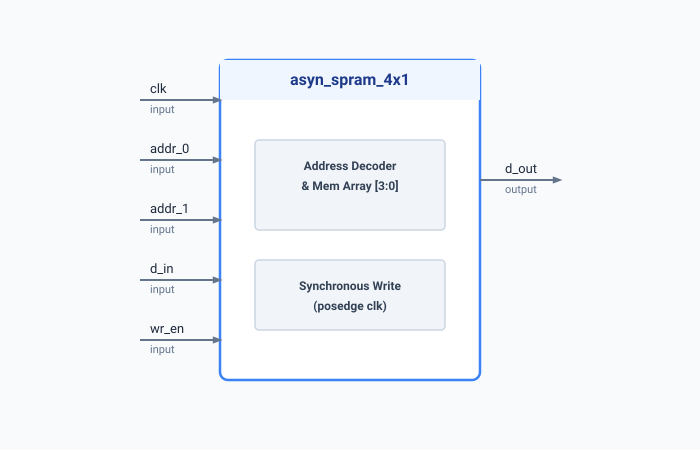

.. _datasheet_ram_asyn_spram_4x1:

4x1 Asynchronous Read SPRAM
---------------------------

Introduction
~~~~~~~~~~~~

This benchmark tests a single-port random access memory (SPRAM) with a capacity of 4 bits, organized as a :math:`4 \times 1`-bit array.
The module supports synchronous write operations on the rising edge of the clock and asynchronous read operations.

Source codes
~~~~~~~~~~~~

See details in ``ram/asyn_spram_4x1``

Block Diagram
~~~~~~~~~~~~~

  4x1 Asyn Read SPRAMschematic

Performance
~~~~~~~~~~~

Expect to consume minimal logic cell resources (LUTs and a 4-bit memory register).

.. list-table:: Estimated Resource Utilization
  :header-rows: 1
  :class: longtable

  * - Benchmark
    - Inputs
    - Outputs
    - LUTs
    - FF / Registers
    - Carry
    - DSP
    - BRAM
  * - ASYN_SPRAM_4X1
    - 5
    - 1
    - 4
    - 4
    - 0
    - 0
    - 0
