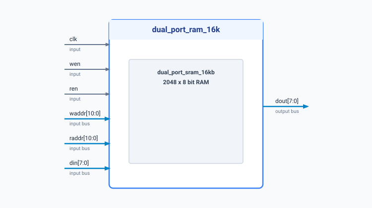

.. _datasheet_ram_dual_port_ram_16k:

Dual-Port RAM 16K (2048x8)
--------------------------

Introduction
~~~~~~~~~~~~

This benchmark tests Block RAM (BRAM) primitive inferencing and basic dual-port memory functionality[cite: 3].
The module instantiates a 2048x8-bit dual-port RAM (``dual_port_sram_16kb``) with independent write and read address/control buses driven by a shared clock (``clk``)[cite: 3].

Source codes
~~~~~~~~~~~~

See details in ``ram/dual_port_ram_16k``

Block Diagram
~~~~~~~~~~~~~

  Dual-Port RAM 16K schematic

Performance
~~~~~~~~~~~

Expect to consume BRAM primitives (or equivalent memory logic resources)[cite: 3].

.. list-table:: Estimated Resource Utilization
  :header-rows: 1
  :class: longtable

  * - Benchmark
    - Inputs
    - Outputs
    - LUTs
    - FF / Registers
    - Carry
    - DSP
    - BRAM
  * - DUAL_PORT_RAM_16K
    - 25
    - 8
    - 0
    - 8
    - 0
    - 0
    - 1
