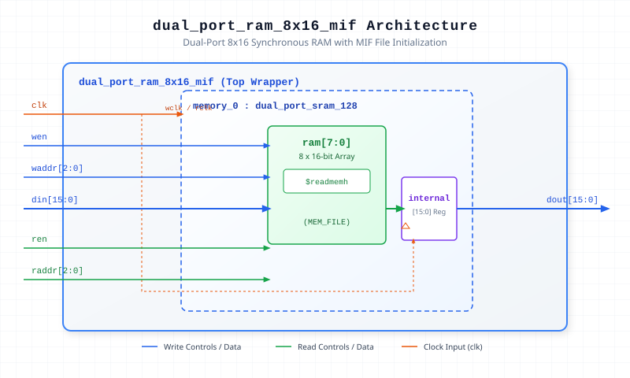

.. _datasheet_dual_port_ram_8x16_mif:

Dual-Port 8x16 RAM with MIF Initialization (dual_port_ram_8x16_mif)
------------------------------------------------------------------

Introduction
~~~~~~~~~~~~

The ``dual_port_ram_8x16_mif`` module implements an 8x16-bit dual-port SRAM wrapped with memory initialization support via a *Memory Initialization File* (MIF) loaded through ``$readmemh``. It instantiates the underlying ``dual_port_sram_128`` component, providing independent control for synchronous write and read operations with parameterized file loading.

Source Codes
~~~~~~~~~~~~

See details in ``ram/dual_port_ram_8x16_mif_multi_clk/dual_port_ram_8x16_mif``

Block Diagram
~~~~~~~~~~~~~

  Dual-Port RAM with MIF Initialization schematic

Ports
~~~~~

.. list-table:: Module Ports
  :header-rows: 1
  :class: longtable

  * - Port Name
    - Direction
    - Width
    - Description
  * - ``clk``
    - Input
    - 1
    - System clock input for both read and write operations.
  * - ``wen``
    - Input
    - 1
    - Write enable control input.
  * - ``ren``
    - Input
    - 1
    - Read enable control input.
  * - ``waddr``
    - Input
    - 3
    - Write address bus (depth of 8 locations).
  * - ``raddr``
    - Input
    - 3
    - Read address bus (depth of 8 locations).
  * - ``din``
    - Input
    - 16
    - Data input bus.
  * - ``dout``
    - Output
    - 16
    - Synchronous data output busx.

Performance & Resource Utilization
~~~~~~~~~~~~~~~~~~~~~~~~~~~~~~~~~~

Estimated hardware resource usage when targeted for standard modern FPGA architectures:

.. list-table:: Estimated Resource Utilization
  :header-rows: 1
  :class: longtable

  * - Benchmark
    - Inputs
    - Outputs
    - LUT5
    - FF
    - DSP
    - BRAM
  * - Dual-Port RAM 8x16 (MIF)
    - 23
    - 16
    - 0
    - 16
    - 0
    - 1
