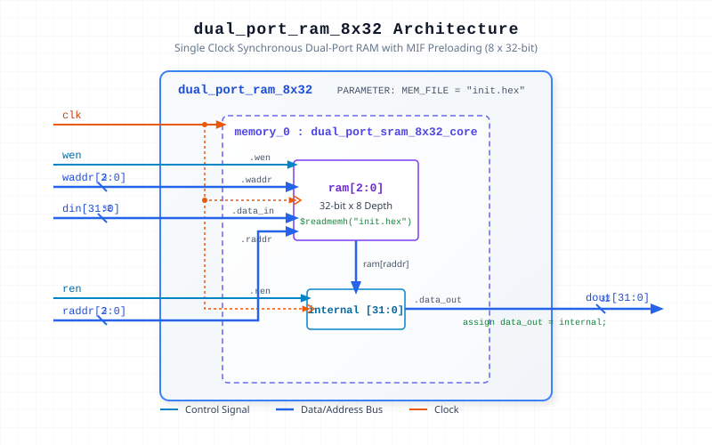

.. _datasheet_ram_dual_port_ram_8x32_mif:

Dual-Port RAM 8x32 MIF Single Clock MIF
---------------------------------------

Introduction
~~~~~~~~~~~~

This benchmark tests Block RAM (BRAM) primitive inferencing, memory initialization (`.hex` / `.mif` files), and basic dual-port memory functionality.
The module instantiates an 8-depth by 32-bit width dual-port RAM with a shared system clock.

Source codes
~~~~~~~~~~~~

See details in ``ram/dual_port_ram_8x32_mif``

Block Diagram
~~~~~~~~~~~~~

  Dual-Port RAM 8x32 MIF Single Clock schematic

Performance
~~~~~~~~~~~

Expect to consume equivalent Block RAM or distributed RAM primitives.

.. list-table:: Estimated Resource Utilization
  :header-rows: 1
  :class: longtable

  * - Benchmark
    - Inputs
    - Outputs
    - LUT5
    - FF
    - Carry
    - DSP
    - BRAM
  * - Single-Clock
    - 42
    - 32
    - 32
    - 32
    - 0
    - 0
    - 1
