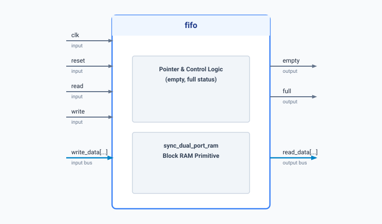

.. _datasheet_ram_fifo:

Synchronous FIFO Buffer
-----------------------

Introduction
~~~~~~~~~~~~

This benchmark implements a synchronous FIFO buffer utilizing an underlying synchronous dual-port block RAM primitive. 
The module supports parameterized address widths and data widths, providing safe read/write pointers with `empty` and `full` status indicators.

Source codes
~~~~~~~~~~~~

See details in ``ram/fifo``

Block Diagram
~~~~~~~~~~~~~

  Synchronous FIFO schematic

Performance
~~~~~~~~~~~

Expect to consume BRAM primitives and logic resources for control pointer management.

.. list-table:: Estimated Resource Utilization
  :header-rows: 1
  :class: longtable

  * - Benchmark
    - Inputs
    - Outputs
    - LUTs
    - FF / Registers
    - Carry
    - DSP
    - BRAM
  * - FIFO
    - 11
    - 6
    - 12
    - 14
    - 0
    - 0
    - 1
