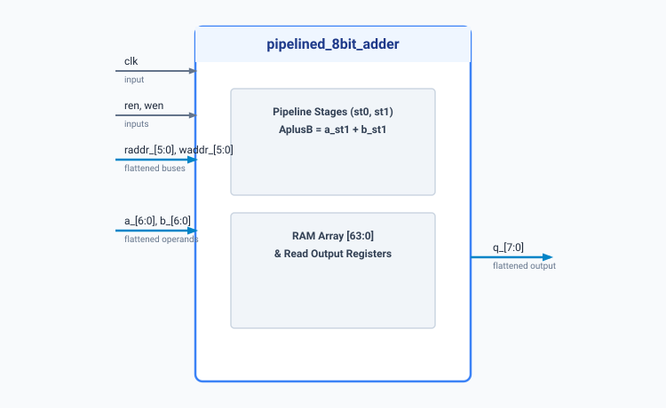

.. _datasheet_ram_pipelined_8bit_adder:

Pipelined 8-Bit Adder with RAM Caching
--------------------------------------

Introduction
~~~~~~~~~~~~

This benchmark implements a pipelined 8-bit adder whose sum and carry outputs are cached in an internal memory block. 
The design uses bit-flattened input and output buses to match BLIF primitive verification formats, incorporating a multi-stage pipeline (`st0`, `st1`) for performance optimization prior to RAM storage.

Source codes
~~~~~~~~~~~~

See details in ``ram/pipelined_8bit_adder``

Block Diagram
~~~~~~~~~~~~~

  Pipelined 8-Bit Adder schematic

Performance
~~~~~~~~~~~

Consumes combinatorial logic resources for pipelined addition alongside registers and memory primitives for data caching.

.. list-table:: Estimated Resource Utilization
  :header-rows: 1
  :class: longtable

  * - Benchmark
    - Inputs
    - Outputs
    - LUTs
    - FF / Registers
    - Carry
    - DSP
    - BRAM
  * - PIPELINED_8BIT_ADDER
    - 29
    - 8
    - 16
    - 32
    - 6
    - 0
    - 1
