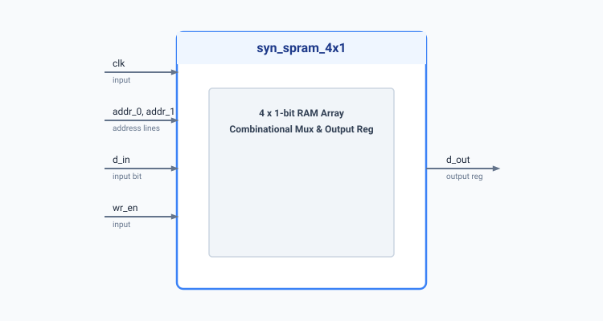

.. _datasheet_ram_syn_spram_4x1:

Synchronous 4x1 Single-Port RAM
--------------------------------

Introduction
~~~~~~~~~~~~

This benchmark implements a 4x1-bit single-port memory with synchronous write and synchronous read register updating. 
The design uses bit-flattened address lines (`addr_0`, `addr_1`) to select between four 1-bit memory words.

Source codes
~~~~~~~~~~~~

See details in ``ram/syn_spram_4x1``

Block Diagram
~~~~~~~~~~~~~

  Synchronous 4x1 RAM schematic

Performance
~~~~~~~~~~~

Consumes minimal memory registers and combinatorial logic for address decoding.

.. list-table:: Estimated Resource Utilization
  :header-rows: 1
  :class: longtable

  * - Benchmark
    - Inputs
    - Outputs
    - LUTs
    - FF / Registers
    - Carry
    - DSP
    - BRAM
  * - SYN_SPRAM_4X1
    - 5
    - 1
    - 4
    - 5
    - 0
    - 0
    - 0
