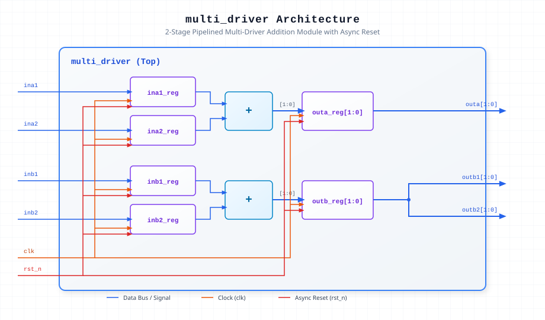

.. _datasheet_simple_gates_multi_driver:

Pipelined Multi-Driver Addition Module (multi_driver)
-----------------------------------------------------

Introduction
~~~~~~~~~~~~

The ``multi_driver`` module implements a dual-channel pipelined adder that registers inputs on the system clock (`clk`) and performs 1-bit additions with an active-low asynchronous reset (`rst_n`). It computes Channel A (``outa = ina1_reg + ina2_reg``) and Channel B duplicated outputs (``outb1 = outb2 = inb1_reg + inb2_reg``) with a 2-cycle pipeline latency.

Source Codes
~~~~~~~~~~~~

See details in ``simple_gates/multi_driver``

Block Diagram
~~~~~~~~~~~~~

  Pipelined Multi-Driver Addition schematic

Ports
~~~~~

.. list-table:: Module Ports
  :header-rows: 1
  :class: longtable

  * - Port Name
    - Direction
    - Width
    - Description
  * - ``clk``
    - Input
    - 1
    - System clock input.
  * - ``rst_n``
    - Input
    - 1
    - Active-low asynchronous reset input.
  * - ``ina1``
    - Input
    - 1
    - Channel A operand 1 input.
  * - ``ina2``
    - Input
    - 1
    - Channel A operand 2 input.
  * - ``outa``
    - Output
    - 2
    - Channel A pipelined addition output.
  * - ``inb1``
    - Input
    - 1
    - Channel B operand 1 input.
  * - ``inb2``
    - Input
    - 1
    - Channel B operand 2 input.
  * - ``outb1``
    - Output
    - 2
    - Channel B pipelined addition output (primary driver).
  * - ``outb2``
    - Output
    - 2
    - Channel B pipelined addition output (duplicated driver).

Performance & Resource Utilization
~~~~~~~~~~~~~~~~~~~~~~~~~~~~~~~~~~

Estimated hardware resource usage when targeted for standard modern FPGA architectures:

.. list-table:: Estimated Resource Utilization
  :header-rows: 1
  :class: longtable

  * - Benchmark
    - Inputs
    - Outputs
    - LUT5
    - FF
    - DSP
    - BRAM
  * - Multi-Driver Pipelined Adder
    - 6
    - 6
    - 4
    - 8
    - 0
    - 0
