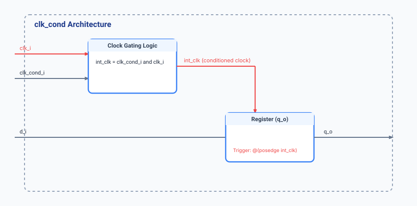

.. _datasheet_simple_registers_clk_cond:

clk_cond
--------

Introduction
~~~~~~~~~~~~

The ``clk_cond`` module implements a locally generated clock signal used for testing clock networks with internal drivers[cite: 3]. 
It combines an external reference clock (``clk_i``) with a gating condition input (``clk_cond_i``) via an internal combinatorial AND gate (``int_clk``) to drive a registered data path (``q_o <= d_i``).

Source codes
~~~~~~~~~~~~

See details in ``simple_registers/clk_cond.v``

Block Diagram
~~~~~~~~~~~~~

  clk_cond schematic

Performance
~~~~~~~~~~~

Expect to consume minimal FPGA resources (typically 1 LUT/gate and 1 register) for locally gated clock conditioning and internal clock network testing.

.. warning:: The following resource utilization is just an estimation! Different tools in different versions may result differently.

.. list-table:: Estimated Resource Utilization
  :header-rows: 1
  :class: longtable

  * - Tool/Resource
    - Inputs
    - Outputs
    - LUT4
    - FF
    - Carry
    - DSP
    - BRAM
  * - General
    - 3
    - 1
    - 1
    - 1
    - 0
    - 0
    - 0

IO Ports
~~~~~~~~

.. table:: clk_cond Top-Level Ports

  +--------------+-------+-----------+------------------------------------+
  | Port         | Width | Direction | Description                        |
  +--------------+-------+-----------+------------------------------------+
  | clk_i        | 1     | Input     | Primary reference system clock     |
  +--------------+-------+-----------+------------------------------------+
  | clk_cond_i   | 1     | Input     | Clock gating condition input       |
  +--------------+-------+-----------+------------------------------------+
  | d_i          | 1     | Input     | Data input                         |
  +--------------+-------+-----------+------------------------------------+
  | q_o          | 1     | Output    | Registered data output             |
  +--------------+-------+-----------+------------------------------------+
