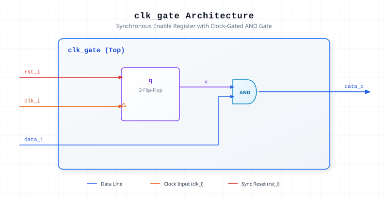

.. _datasheet_simple_registers_clk_gate:

clk_gate
--------

Introduction
~~~~~~~~~~~~

The ``clk_gate`` module implements a synchronous clock-gated logic block. It utilizes an internal register (``q``) controlled by a synchronous active-high reset (``rst_i``) on the positive edge of the clock signal (``clk_i``), which gates the input data (``data_i``) via an AND operation to produce ``data_o``.

Source Codes
~~~~~~~~~~~~

See details in ``simple_registers/clk_gate``

Block Diagram
~~~~~~~~~~~~~

  Clock-Gated AND Module schematic

Ports
~~~~~

.. list-table:: Module Ports
  :header-rows: 1
  :class: longtable

  * - Port Name
    - Direction
    - Width
    - Description
  * - ``rst_i``
    - Input
    - 1
    - Active-high synchronous reset input.
  * - ``clk_i``
    - Input
    - 1
    - System clock input.
  * - ``data_i``
    - Input
    - 1
    - Data input to be gated.
  * - ``data_o``
    - Output
    - 1
    - Clock-gated output (``data_i & q``).

Performance & Resource Utilization
~~~~~~~~~~~~~~~~~~~~~~~~~~~~~~~~~~

Estimated hardware resource usage when targeted for standard modern FPGA architectures:

.. list-table:: Estimated Resource Utilization
  :header-rows: 1
  :class: longtable

  * - Benchmark
    - Inputs
    - Outputs
    - LUT5
    - FF
    - DSP
    - BRAM
  * - Clock-Gated AND Gate
    - 3
    - 1
    - 2
    - 1
    - 0
    - 0
