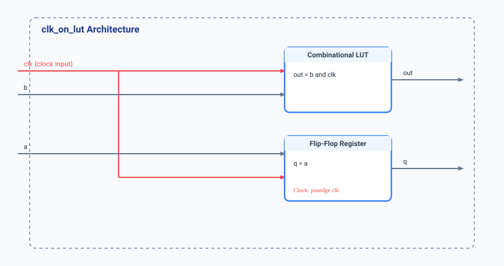

.. _datasheet_simple_registers_clk_on_lut:

clk_on_lut
----------

Introduction
~~~~~~~~~~~~

The ``clk_on_lut`` module demonstrates a hybrid clocking and logic structure where the system clock (``clk``) is used simultaneously as a synchronous clock trigger for a register stage (``q <= a``) and as a direct combinatorial data input to a Look-Up Table (LUT) / AND gate (``out = b & clk``). This benchmark is specifically designed for evaluating clock-to-data routing paths and clock-enabled LUT mapping within FPGA logic elements.

Source codes
~~~~~~~~~~~~

See details in ``simple_registers/clk_on_lut.v``

Block Diagram
~~~~~~~~~~~~~

  clk_on_lut schematic

Performance
~~~~~~~~~~~

Expect to consume minimal FPGA resources (typically 1 LUT and 1 Flip-Flop). Note that routing the system clock directly into LUT combinational inputs may introduce clock distribution constraints or dedicated routing requirements depending on the target architecture.

.. warning:: The following resource utilization is just an estimation! Different tools in different versions may result differently.

.. list-table:: Estimated Resource Utilization
  :header-rows: 1
  :class: longtable

  * - Tool/Resource
    - Inputs
    - Outputs
    - LUT4
    - FF
    - Carry
    - DSP
    - BRAM
  * - General
    - 3
    - 2
    - 1
    - 1
    - 0
    - 0
    - 0

IO Ports
~~~~~~~~

.. table:: clk_on_lut Top-Level Ports

  +------------+-------+-----------+------------------------------------+
  | Port       | Width | Direction | Description                        |
  +------------+-------+-----------+------------------------------------+
  | clk        | 1     | Input     | System clock input                 |
  +------------+-------+-----------+------------------------------------+
  | a          | 1     | Input     | Data input to synchronous register |
  +------------+-------+-----------+------------------------------------+
  | b          | 1     | Input     | Gating enable input for clock LUT  |
  +------------+-------+-----------+------------------------------------+
  | q          | 1     | Output    | Registered output (q <= a)         |
  +------------+-------+-----------+------------------------------------+
  | out        | 1     | Output    | Combinational output (out = b & clk)|
  +------------+-------+-----------+------------------------------------+
