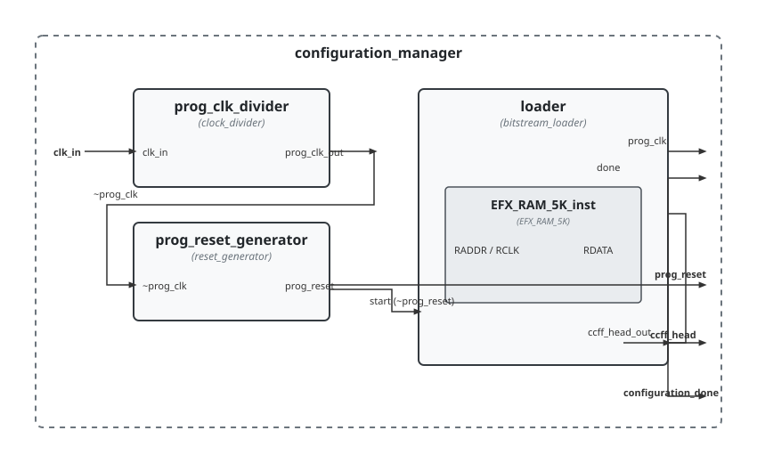

.. _datasheet_simple_registers_config_loader:

Config Loader
-------------

Introduction
~~~~~~~~~~~~

This module is designed to manage the FPGA configuration sequence. It drives a bitstream loader backed by an embedded block RAM (`EFX_RAM_5K`) to feed configuration data into the configuration chain, governed by a configurable clock divider and a startup reset generator.

Source codes
~~~~~~~~~~~~

See details in ``simple_registers/config_loader``

Block Diagram
~~~~~~~~~~~~~

  Configuration loader schematic

Performance
~~~~~~~~~~~

Expect to consume control logic (LUTs and flip-flops) for clock division, reset generation, and bitstream index tracking, along with one embedded block RAM (`EFX_RAM_5K`) for storing the configuration bitstream data.

.. warning:: The following resource utilization is just an estimation! Different tools in different versions may result differently.

.. list-table:: Estimated resource Utilization
  :header-rows: 1
  :class: longtable

  * - Tool/Resource
    - Inputs
    - Outputs
    - LUT4
    - FF
    - Carry
    - DSP
    - BRAM
  * - General
    - 1
    - 4
    - ~50
    - ~40
    - 0
    - 0
    - 1
