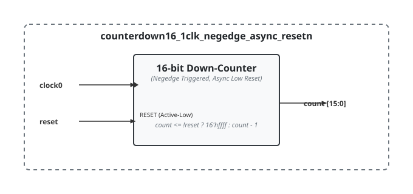

.. _datasheet_counter16_Nclk_pnedge_async_resetpn:

counter16
---------

Introduction
~~~~~~~~~~~~

There are a number of variations of the 16-bit counters. 

These modules implement 16-bit up/down-counters triggered on the positive/negative edge of the clock (`clock0`) with an active-low/high asynchronous/synchronous reset (`reset`). Upon reset, the counter value is initialized to `16'hffff`, and decrements by 1 on each rising/falling clock edge during normal operation.

Source codes
~~~~~~~~~~~~

All the counter designs are under ``simple_registers/counters``, in the naming convention of ``counter[up|down]16_Nclk_[pos|neg]edge_[a]sync_reset[p|n]``.
See details in the :ref:`developer_naming_convention`` on the counter names.

A list of all the designs available:
  
- counterdown16_1clk_negedge_async_resetn
- counterdown16_1clk_negedge_async_resetp
- counterdown16_1clk_negedge_sync_resetn
- counterdown16_1clk_negedge_sync_resetp
- counterdown16_1clk_posedge_async_resetn
- counterdown16_1clk_posedge_async_resetp
- counterdown16_1clk_posedge_sync_resetn
- counterdown16_1clk_posedge_sync_resetp
- counterdown16_4clk_posedge_async_resetn
- counterup16_1clk_negedge_async_resetn
- counterup16_1clk_negedge_async_resetp
- counterup16_1clk_negedge_sync_resetn
- counterup16_1clk_negedge_sync_resetp
- counterup16_1clk_posedge_async_resetn
- counterup16_1clk_posedge_async_resetp
- counterup16_1clk_posedge_sync_resetn
- counterup16_1clk_posedge_sync_resetp
- counterup16_4clk_posedge_async_resetn
- counterup16_7clk_posedge_async_resetn
- counterup16_8clk_posedge_async_resetn

Block Diagram
~~~~~~~~~~~~~

Here is an example of the 16-bit counter with

- Single clock
- Triggered at negative edge
- Asynchronous active-low reset 

  counterdown16_1clk_negedge_async_resetn schematic

Performance
~~~~~~~~~~~

Expect to consume 16 flip-flops and associated arithmetic carry and LUT logic to support the 16-bit wide decrementer and asynchronous active-low reset path.

.. warning:: The following resource utilization is just an estimation! Different tools in different versions may result differently.

.. list-table:: Estimated Resource Utilization for 16-bit Counter Library
  :header-rows: 1
  :class: longtable

  * - Design Name
    - Inputs
    - Outputs
    - LUT4
    - FF
    - Carry
    - DSP
    - BRAM
  * - counterdown16_1clk_negedge_async_resetn
    - 2
    - 16
    - ~16
    - 16
    - ~4
    - 0
    - 0
  * - counterdown16_1clk_negedge_async_resetp
    - 2
    - 16
    - ~16
    - 16
    - ~4
    - 0
    - 0
  * - counterdown16_1clk_negedge_sync_resetn
    - 2
    - 16
    - ~16
    - 16
    - ~4
    - 0
    - 0
  * - counterdown16_1clk_negedge_sync_resetp
    - 2
    - 16
    - ~16
    - 16
    - ~4
    - 0
    - 0
  * - counterdown16_1clk_posedge_async_resetn
    - 2
    - 16
    - ~16
    - 16
    - ~4
    - 0
    - 0
  * - counterdown16_1clk_posedge_async_resetp
    - 2
    - 16
    - ~16
    - 16
    - ~4
    - 0
    - 0
  * - counterdown16_1clk_posedge_sync_resetn
    - 2
    - 16
    - ~16
    - 16
    - ~4
    - 0
    - 0
  * - counterdown16_1clk_posedge_sync_resetp
    - 2
    - 16
    - ~16
    - 16
    - ~4
    - 0
    - 0
  * - counterdown16_4clk_posedge_async_resetn
    - 5
    - 64
    - ~64
    - 64
    - ~16
    - 0
    - 0
  * - counterup16_1clk_negedge_async_resetn
    - 2
    - 16
    - ~16
    - 16
    - ~4
    - 0
    - 0
  * - counterup16_1clk_negedge_async_resetp
    - 2
    - 16
    - ~16
    - 16
    - ~4
    - 0
    - 0
  * - counterup16_1clk_negedge_sync_resetn
    - 2
    - 16
    - ~16
    - 16
    - ~4
    - 0
    - 0
  * - counterup16_1clk_negedge_sync_resetp
    - 2
    - 16
    - ~16
    - 16
    - ~4
    - 0
    - 0
  * - counterup16_1clk_posedge_async_resetn
    - 2
    - 16
    - ~16
    - 16
    - ~4
    - 0
    - 0
  * - counterup16_1clk_posedge_async_resetp
    - 2
    - 16
    - ~16
    - 16
    - ~4
    - 0
    - 0
  * - counterup16_1clk_posedge_sync_resetn
    - 2
    - 16
    - ~16
    - 16
    - ~4
    - 0
    - 0
  * - counterup16_1clk_posedge_sync_resetp
    - 2
    - 16
    - ~16
    - 16
    - ~4
    - 0
    - 0
  * - counterup16_4clk_posedge_async_resetn
    - 5
    - 64
    - ~64
    - 64
    - ~16
    - 0
    - 0
  * - counterup16_7clk_posedge_async_resetn
    - 8
    - 112
    - ~112
    - 112
    - ~28
    - 0
    - 0
  * - counterup16_8clk_posedge_async_resetn
    - 9
    - 128
    - ~128
    - 128
    - ~32
    - 0
    - 0
