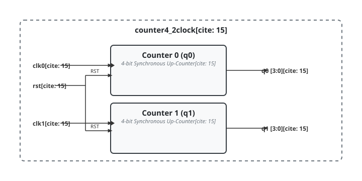

.. _datasheet_simple_registers_counter4_2clock:

counter4_2clock
---------------

Introduction
~~~~~~~~~~~~

This module implements two independent 4-bit synchronous up-counters driven by separate clock domains (`clk0` and `clk1`) while sharing a common reset signal (`rst`). Each counter increments independently on the rising edge of its respective clock when reset is inactive.

Source codes
~~~~~~~~~~~~

See details in ``simple_registers/counters/counter4_2clock``

Block Diagram
~~~~~~~~~~~~~

  counter4_2clock schematic

Performance
~~~~~~~~~~~

Expect to consume two 4-bit counter pipelines, requiring a total of 8 flip-flops and supporting LUT logic to handle the dual independent clock domains.

.. warning:: The following resource utilization is just an estimation! Different tools in different versions may result differently.

.. list-table:: Estimated resource Utilization
  :header-rows: 1
  :class: longtable

  * - Tool/Resource
    - Inputs
    - Outputs
    - LUT4
    - FF
    - Carry
    - DSP
    - BRAM
  * - General
    - 3[cite: 15]
    - 2[cite: 15]
    - ~8
    - 8[cite: 15]
    - ~2
    - 0
    - 0
