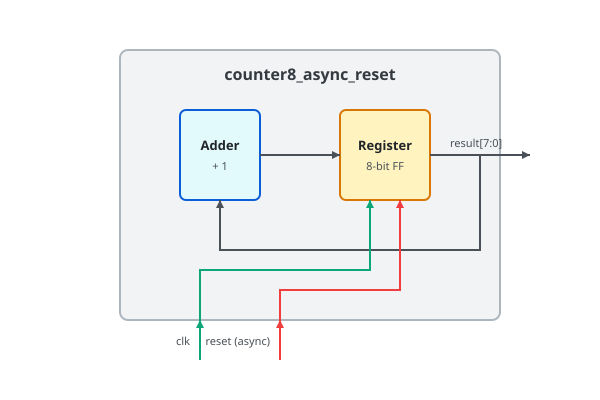

.. _datasheet_counter8_async_reset:

Counter 8-bit
-------------

Introduction
~~~~~~~~~~~~

This benchmark is designed to test flip-flops and registers with an asynchronous reset in FPGAs.
It generates an 8-bit counter operating on a single clock signal (``clk``).
The counter includes an active-high/low synchronous/asynchronous reset input (``reset``).
When the reset signal is asserted high, the counter output is immediately cleared to 0 regardless of clock transitions.

Source codes
~~~~~~~~~~~~

All the counter designs are under ``simple_registers/counters``, in the naming convention of ``counter8_[a]sync_reset[b]``.

A list of all the designs available:

- ``counter8_async_reset``
- ``counter8_async_resetb``
- ``counter8_sync_reset``

Block Diagram
~~~~~~~~~~~~~

The following is an example for the 8-bit counter with asynchronous active-high reset

  Counter 8-bit Asynchronous Reset schematic

Performance
~~~~~~~~~~~

Expect to consume only 8 flip-flops and minimal LUT logic of an FPGA.
It can evaluate the routability and performance of single-clock networks and flip-flop asynchronous reset trees.

.. warning:: The following resource utilization is just an estimation! Different tools in different versions may result differently.

.. list-table:: Estimated resource Utilization
  :header-rows: 1
  :class: longtable

  * - Tool/Resource
    - Inputs
    - Outputs
    - LUT5
    - FF
    - Carry
    - DSP
    - BRAM
  * - counter8_async_reset
    - 2
    - 8
    - 8
    - 8
    - 0
    - 0
    - 0
  * - counter8_async_resetb
    - 2
    - 8
    - 8
    - 8
    - 0
    - 0
    - 0
  * - counter8_sync_reset
    - 2
    - 8
    - 8
    - 8
    - 0
    - 0
    - 0
