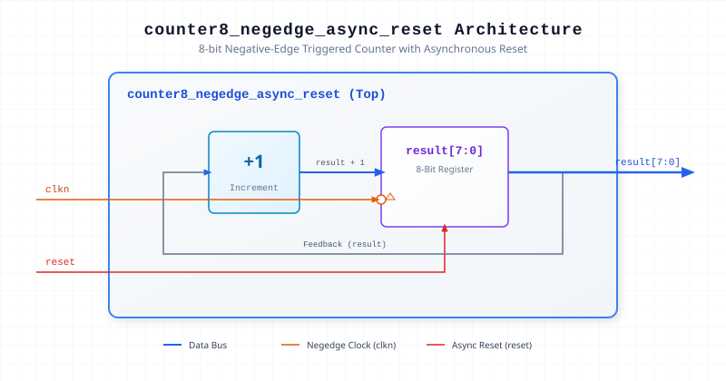

.. _datasheet_simple_registers_counter8_negedge_async_reset:

counter8_negedge_async_reset
----------------------------

Introduction
~~~~~~~~~~~~

The ``counter8_negedge_async_reset`` module implements an 8-bit counter that increments on the negative edge of the clock signal (`clkn`) and features an active-high asynchronous reset (`reset`). Upon assertion of the asynchronous reset, the counter value immediately clears to zero.

Source Codes
~~~~~~~~~~~~

See details in ``simple_registers/counters/counter8_negedge_async_reset``

Block Diagram
~~~~~~~~~~~~~

  8-bit Negative-Edge Counter schematic

Ports
~~~~~

.. list-table:: Module Ports
  :header-rows: 1
  :class: longtable

  * - Port Name
    - Direction
    - Width
    - Description
  * - ``clkn``
    - Input
    - 1
    - Negative-edge triggered clock input.
  * - ``reset``
    - Input
    - 1
    - Active-high asynchronous reset input.
  * - ``result``
    - Output
    - 8
    - 8-bit counter register output.

Performance & Resource Utilization
~~~~~~~~~~~~~~~~~~~~~~~~~~~~~~~~~~

Estimated hardware resource usage when targeted for standard modern FPGA architectures:

.. list-table:: Estimated Resource Utilization
  :header-rows: 1
  :class: longtable

  * - Benchmark
    - Inputs
    - Outputs
    - LUT5
    - FF
    - DSP
    - BRAM
  * - 8-bit Negedge Counter
    - 2
    - 8
    - 8
    - 8
    - 0
    - 0
