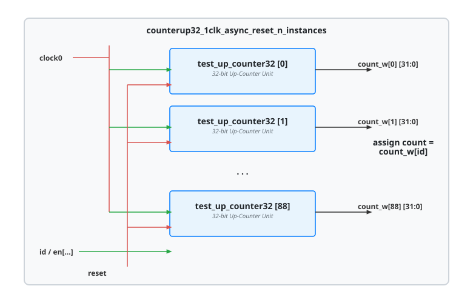

.. _datasheet_simple_registers_counterup32_1clk_async_reset_n_instances:

counterup32_1clk_async_reset_n_instances
----------------------------------------

Introduction
~~~~~~~~~~~~

This module implements a scalable multi-instance array of 32-bit synchronous up-counters driven by a single clock domain (`clock0`), an active-high asynchronous reset (`reset`), and a parameterized number of parallel counter instances (`counter_instance`) controlled via an index selector (`id`). Each inner unit increments on the positive edge of the clock when enabled and cleared asynchronously by the reset signal.

Source codes
~~~~~~~~~~~~

See details in ``simple_registers/counters/counterup32_1clk_async_reset_n_instances``

Block Diagram
~~~~~~~~~~~~~

  counterup32_1clk_async_reset_n_instances schematic

Performance
~~~~~~~~~~~

Expect to consume 32 flip-flops per counter instance along with associated carry-chain and LUT arithmetic logic, scaling with the parameterized instance count.

.. warning:: The following resource utilization is just an estimation! Different tools in different versions may result differently.

.. list-table:: Estimated resource Utilization
  :header-rows: 1
  :class: longtable

  * - Tool/Resource
    - Inputs
    - Outputs
    - LUT4
    - FF
    - Carry
    - DSP
    - BRAM
  * - General
    - 3
    - 32
    - ~32 (per instance)
    - 32
    - ~8
    - 0
    - 0
