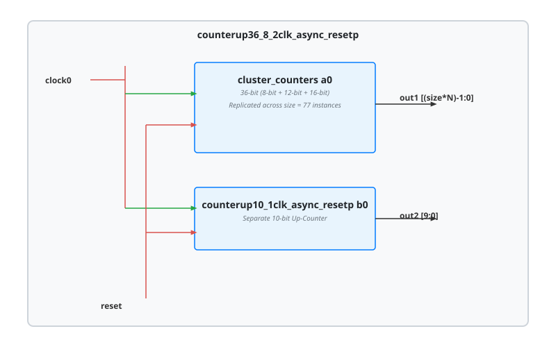

.. _datasheet_simple_registers_counterup36_8_2clk_async_resetp:

counterup36_8_2clk_async_resetp
-------------------------------

Introduction
~~~~~~~~~~~~

This module implements a composite counter system containing a parameterized 36-bit cluster counter (built from concatenated 8-bit, 12-bit, and 16-bit sub-counters and replicated across 77 parallel instances) alongside a separate 10-bit up-counter. Both systems operate under a shared clock (`clock0`) and active-high asynchronous reset (`reset`).

Source codes
~~~~~~~~~~~~

See details in ``simple_registers/counters/counterup36_8_2clk_async_resetp``.

Block Diagram
~~~~~~~~~~~~~

  counterup36_8_2clk_async_resetp schematic

Performance
~~~~~~~~~~~

Expect to consume flip-flops and carry-chain logic scaling with the total aggregate bit-width (77 replicated instances of the 36-bit cluster counter plus the 10-bit counter).

.. warning:: The following resource utilization is just an estimation! Different tools in different versions may result differently.

.. list-table:: Estimated resource Utilization
  :header-rows: 1
  :class: longtable

  * - Tool/Resource
    - Inputs
    - Outputs
    - LUT4
    - FF
    - Carry
    - DSP
    - BRAM
  * - General
    - 2
    - 2,782
    - ~2,800
    - 2,782
    - ~700
    - 0
    - 0
