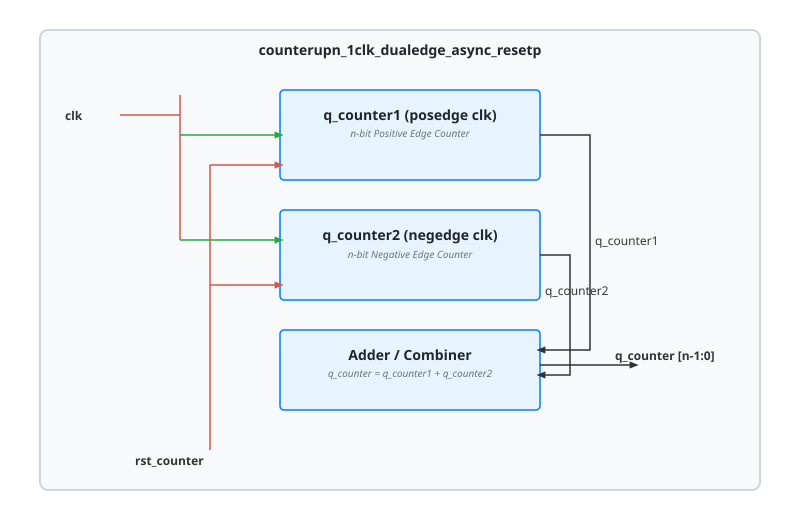

.. _datasheet_simple_registers_counterupn_1clk_dualedge_async_resetp:

counterupn_1clk_dualedge_async_resetp
-------------------------------------

Introduction
~~~~~~~~~~~~

This module implements a parameterized $n$-bit dual-edge triggered up-counter. It maintains two parallel registers (`q_counter1` and `q_counter2`) incrementing respectively on the positive and negative edges of the clock (`clk`), both governed by an active-high asynchronous reset (`rst_counter`). The final output (`q_counter`) represents the sum of both edge-triggered counters.

Source codes
~~~~~~~~~~~~

See details in ``simple_registers/counters/counterupn_1clk_dualedge_async_resetp``.

Block Diagram
~~~~~~~~~~~~~

  counterupn_1clk_dualedge_async_resetp schematic

Performance
~~~~~~~~~~~

Expect to consume $2n$ flip-flops, dual-edge clock network resources, and an $n$-bit adder to combine the positive and negative edge counts.

.. warning:: The following resource utilization is just an estimation! Different tools in different versions may result differently.

.. list-table:: Estimated resource Utilization
  :header-rows: 1
  :class: longtable

  * - Tool/Resource
    - Inputs
    - Outputs
    - LUT4
    - FF
    - Carry
    - DSP
    - BRAM
  * - General
    - 2
    - 12
    - ~24
    - 24
    - ~6
    - 0
    - 0
