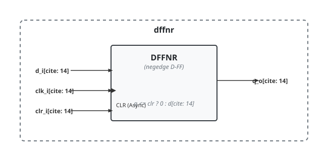

.. _datasheet_simple_registers_dffnr:

dffnr
-----

Introduction
~~~~~~~~~~~~

This module implements an active-high asynchronously resettable, negative-edge triggered D flip-flop. 
It samples input data on the falling edge of the clock signal, and its output can be cleared asynchronously to logic low whenever the clear signal is asserted high.

Source codes
~~~~~~~~~~~~

See details in ``simple_registers/ff/dffnr``

Block Diagram
~~~~~~~~~~~~~

  dffnr schematic

Performance
~~~~~~~~~~~

Expect to consume only 1 LUT and 1 flip-flop of an FPGA, providing high-speed storage with asynchronous reset capabilities

.. warning:: The following resource utilization is just an estimation! Different tools in different versions may result differently.

.. list-table:: Estimated resource Utilization
  :header-rows: 1
  :class: longtable

  * - Tool/Resource
    - Inputs
    - Outputs
    - LUT4
    - FF
    - Carry
    - DSP
    - BRAM
  * - General
    - 3
    - 1
    - 1
    - 1
    - 0
    - 0
    - 0
