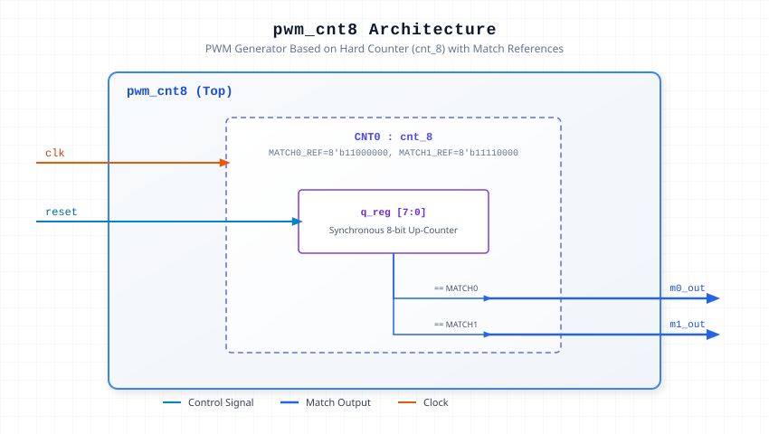

.. _datasheet_simple_registers_pwm_cnt8:

PWM Based on Hard Counter (pwm_cnt8)
------------------------------------

Introduction
~~~~~~~~~~~~

This benchmark tests PWM generation using an 8-bit hard counter (`cnt_8`) with parameterized match references (`MATCH0_REF` and `MATCH1_REF`). 
The module instantiates the counter core and asserts match outputs when the internal counter register reaches the specified threshold values.

Source Codes
~~~~~~~~~~~~

See details in ``simple_registers/pwm/pwm_cnt8``

Block Diagram
~~~~~~~~~~~~~

  PWM Based on Hard Counter schematic

Performance
~~~~~~~~~~~

Expect to consume minimal logic primitives for an 8-bit counter and comparator architecture.

.. list-table:: Estimated Resource Utilization
  :header-rows: 1
  :class: longtable

  * - Benchmark
    - Inputs
    - Outputs
    - LUT5
    - FF
    - Carry
    - DSP
    - BRAM
  * - PWM Counter 8-bit
    - 2
    - 2
    - 12
    - 8
    - 0
    - 0
    - 0
