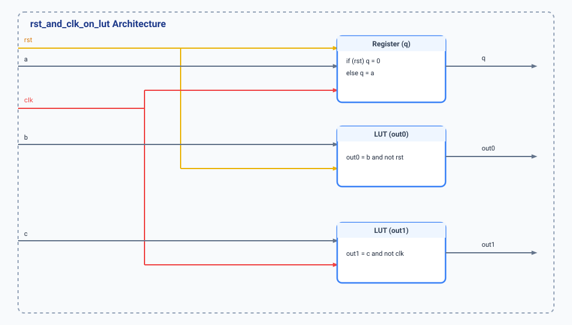

.. _datasheet_simple_registers_rst_and_clk_on_lut:

rst_and_clk_on_lut
------------------

Introduction
~~~~~~~~~~~~

The ``rst_and_clk_on_lut`` module implements a register driven by combinational logic tied to both reset and clock control signals. It features an asynchronously reset register (``q <= a`` when ``rst`` is active) alongside combinatorial output branches ``out0`` (gated by an active-low reset term ``b & ~rst``) and ``out1`` (gated by an inverted clock term ``c & ~clk``). This benchmark evaluates FPGA logic element mapping where reset and clock signals feed directly into Look-Up Tables and control sets.

Source codes
~~~~~~~~~~~~

See details in ``simple_registers/rst_and_clk_on_lut.v``

Block Diagram
~~~~~~~~~~~~~

  rst_and_clk_on_lut schematic

Performance
~~~~~~~~~~~

Expect to consume minimal FPGA resources (typically 2 LUTs/gates and 1 Flip-Flop). The design analyzes resource utilization when control signals (clock and asynchronous reset) dual-purpose as combinational inputs to adjacent LUT logic.

.. warning:: The following resource utilization is just an estimation! Different tools in different versions may result differently.

.. list-table:: Estimated Resource Utilization
  :header-rows: 1
  :class: longtable

  * - Tool/Resource
    - Inputs
    - Outputs
    - LUT4
    - FF
    - Carry
    - DSP
    - BRAM
  * - General
    - 5
    - 3
    - 2
    - 1
    - 0
    - 0
    - 0

IO Ports
~~~~~~~~

.. table:: rst_and_clk_on_lut Top-Level Ports

  +------------+-------+-----------+------------------------------------+
  | Port       | Width | Direction | Description                        |
  +------------+-------+-----------+------------------------------------+
  | rst        | 1     | Input     | Asynchronous reset input |
  +------------+-------+-----------+------------------------------------+
  | clk        | 1     | Input     | System clock input       |
  +------------+-------+-----------+------------------------------------+
  | a          | 1     | Input     | Data input for register  |
  +------------+-------+-----------+------------------------------------+
  | b          | 1     | Input     | Combinational input for out0|
  +------------+-------+-----------+------------------------------------+
  | c          | 1     | Input     | Combinational input for out1|
  +------------+-------+-----------+------------------------------------+
  | q          | 1     | Output    | Registered output        |
  +------------+-------+-----------+------------------------------------+
  | out0       | 1     | Output    | Combinational output (b & ~rst)|
  +------------+-------+-----------+------------------------------------+
  | out1       | 1     | Output    | Combinational output (c & ~clk)|
  +------------+-------+-----------+------------------------------------+
