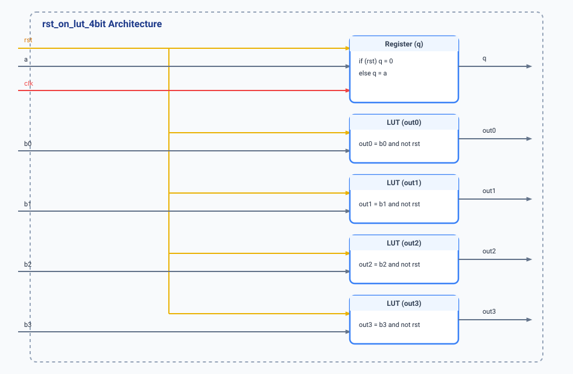

.. _datasheet_simple_registers_rst_on_lut_Nbit:

rst_on_lut_Nbit
---------------

Introduction
~~~~~~~~~~~~

The ``rst_on_lut_Nbit`` module is a N-bit extended variant of the ``rst_on_lut`` benchmark (See details in :ref:`datasheet_simple_registers_rst_on_lut`), featuring a registered data path driven by combinational logic alongside an asynchronous reset signal. It includes an asynchronously reset register (``q <= a`` when ``rst`` is active) and four parallel combinatorial output branches (``out0`` through ``outN``) gated by active-low reset terms (``b0`` to ``bN & ~rst``). This benchmark evaluates FPGA logic mapping efficiency when multiple routing and Look-Up Table elements share common asynchronous control lines.

Source codes
~~~~~~~~~~~~

See details in 

- ``simple_registers/rst_on_lut_Nbit/rst_on_lut_4bit.v``
- ``simple_registers/rst_on_lut_Nbit/rst_on_lut_8bit.v``

Block Diagram
~~~~~~~~~~~~~

  rst_on_lut_4bit schematic

Performance
~~~~~~~~~~~

Expect to consume minimal FPGA resources (typically 4 LUTs/gates for the output gating logic and 1 Flip-Flop for the register). The design analyzes how multiple combinatorial outputs sharing a global reset net scale within local logic blocks.

.. warning:: The following resource utilization is just an estimation! Different tools in different versions may result differently.

.. list-table:: Estimated Resource Utilization
  :header-rows: 1
  :class: longtable

  * - Tool/Resource
    - Inputs
    - Outputs
    - LUT4
    - FF
    - Carry
    - DSP
    - BRAM
  * - rst_on_lut_4bit
    - 7
    - 5
    - 4
    - 1
    - 0
    - 0
    - 0
  * - rst_on_lut_8bit
    - 11
    - 9
    - 8
    - 1
    - 0
    - 0
    - 0

IO Ports
~~~~~~~~

.. table:: rst_on_lut_4bit Top-Level Ports

  +------------+-------+-----------+--------------------------------------------+
  | Port       | Width | Direction | Description                                |
  +------------+-------+-----------+--------------------------------------------+
  | rst        | 1     | Input     | Asynchronous reset input[cite: 5]         |
  +------------+-------+-----------+--------------------------------------------+
  | clk        | 1     | Input     | System clock input[cite: 5]               |
  +------------+-------+-----------+--------------------------------------------+
  | a          | 1     | Input     | Data input for register[cite: 5]          |
  +------------+-------+-----------+--------------------------------------------+
  | b0         | 1     | Input     | Combinational input for out0[cite: 5]     |
  +------------+-------+-----------+--------------------------------------------+
  | b1         | 1     | Input     | Combinational input for out1[cite: 5]     |
  +------------+-------+-----------+--------------------------------------------+
  | b2         | 1     | Input     | Combinational input for out2[cite: 5]     |
  +------------+-------+-----------+--------------------------------------------+
  | b3         | 1     | Input     | Combinational input for out3[cite: 5]     |
  +------------+-------+-----------+--------------------------------------------+
  | q          | 1     | Output    | Registered output[cite: 5]                |
  +------------+-------+-----------+--------------------------------------------+
  | out0       | 1     | Output    | Combinational output (b0 & ~rst)[cite: 5] |
  +------------+-------+-----------+--------------------------------------------+
  | out1       | 1     | Output    | Combinational output (b1 & ~rst)[cite: 5] |
  +------------+-------+-----------+--------------------------------------------+
  | out2       | 1     | Output    | Combinational output (b2 & ~rst)[cite: 5] |
  +------------+-------+-----------+--------------------------------------------+
  | out3       | 1     | Output    | Combinational output (b3 & ~rst)[cite: 5] |
  +------------+-------+-----------+--------------------------------------------+
