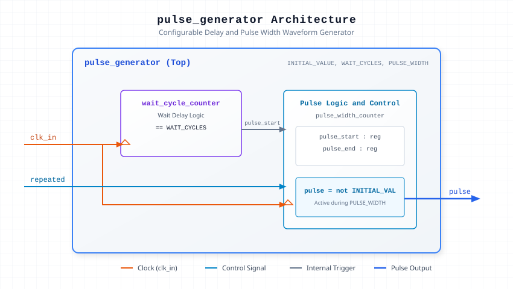

.. _datasheet_simple_registers_signal_gen_pulse_generator:

Configurable Pulse Generator
----------------------------

Introduction
~~~~~~~~~~~~

The ``pulse_generator`` module generates configurable pulse waveforms with adjustable initial logic level, delay cycles before launch, pulse width duration, and single vs. repeated execution modes.

Parameters
~~~~~~~~~~~

.. list-table:: Module Parameters
  :header-rows: 1
  :class: longtable

  * - Parameter
    - Default
    - Description
  * - ``INITIAL_VALUE``
    - ``0``
    - Base state for the pulse output (0 or 1); pulse active state inverts this value.
  * - ``WAIT_CYCLES``
    - ``0``
    - Number of clock cycles to wait before asserting the pulse.
  * - ``PULSE_WIDTH``
    - ``1``
    - Duration of the active pulse in clock cycles.
  * - ``PULSE_COUNTER_SIZE``
    - ``10``
    - Bit width of the internal pulse width counter.

Source Codes
~~~~~~~~~~~~

See details in ``simple_registers/signal_gen/pulse_generator``

Block Diagram
~~~~~~~~~~~~~

  Pulse Generator schematic

Performance & Resource Utilization
~~~~~~~~~~~~~~~~~~~~~~~~~~~~~~~~~~

Resource consumption scales primarily with the configured counter bit widths.

.. list-table:: Estimated Resource Utilization
  :header-rows: 1
  :class: longtable

  * - Benchmark
    - Inputs
    - Outputs
    - LUT5
    - FF
    - Carry
    - DSP
    - BRAM
  * - Pulse Generator
    - 2
    - 1
    - 14
    - 14
    - 0
    - 0
    - 0
