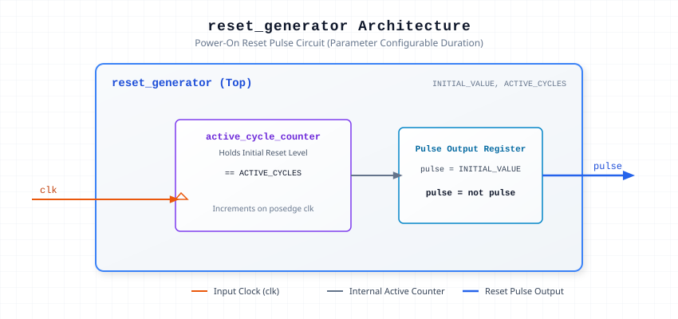

.. _datasheet_simple_registers_signal_gen_reset_generator:

Configurable Reset Generator
----------------------------

Introduction
~~~~~~~~~~~~

The ``reset_generator`` module provides an active reset pulse generator driven by an input clock (`clk`). 
It holds the reset signal at a specified initial logic level (`INITIAL_VALUE`) for a configurable duration of clock cycles (`ACTIVE_CYCLES`) before toggling the pulse level to release or trigger reset.

Parameters
~~~~~~~~~~~

.. list-table:: Module Parameters
  :header-rows: 1
  :class: longtable

  * - Parameter
    - Default
    - Description
  * - ``INITIAL_VALUE``
    - ``0``
    - Initial logic state of the pulse output signal (0 or 1).
  * - ``ACTIVE_CYCLES``
    - ``0``
    - Number of clock cycles to hold the initial active reset state before toggling.

Source Codes
~~~~~~~~~~~~

See details in ``simple_registers/signal_gen/reset_generator``

Block Diagram
~~~~~~~~~~~~~

  Reset Generator schematic

Performance & Resource Utilization
~~~~~~~~~~~~~~~~~~~~~~~~~~~~~~~~~~

Resource utilization scales directly with the counter width derived from ``ACTIVE_CYCLES``.

.. list-table:: Estimated Resource Utilization
  :header-rows: 1
  :class: longtable

  * - Benchmark
    - Inputs
    - Outputs
    - LUT5
    - FF
    - Carry
    - DSP
    - BRAM
  * - Reset Generator
    - 1
    - 1
    - 6
    - 5
    - 0
    - 0
    - 0
